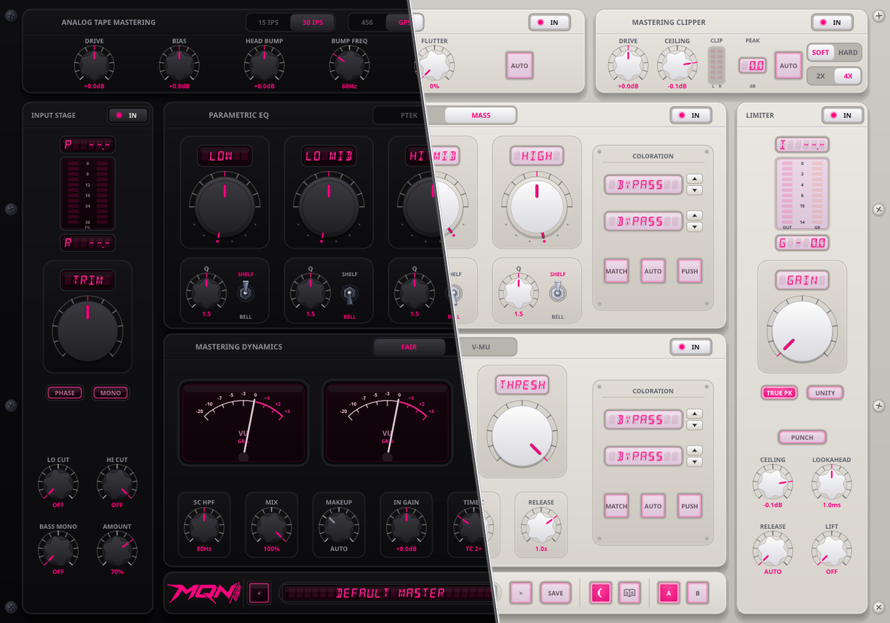

<div align="center">

# Masteraid

**Zero-latency analog mastering console (CLAP / VST3) for Windows and Linux.**

<p align="center">
  <a href="https://www.rust-lang.org/"></a>
  <a href="https://github.com/free-audio/clap"></a>
  <a href="https://www.steinberg.net/vst3/"></a>
  <a href="https://www.airwindows.com/"></a>
  <a href="https://www.microsoft.com/windows"></a>
  <a href="https://www.kernel.org/"></a>
  <a href="LICENSE"></a>
</p>



</div>

---

## What is Masteraid?

Masteraid was built to cure **decision paralysis**. Instead of opening 6 different plugins, menu-diving across disjointed UIs, and second-guessing your ears, Masteraid puts a complete, cohesive mastering chain into a single, distraction-free rack.

I originally developed it to facilitate my own transition to Linux and create an independent, zero-bloat audio ecosystem I could rely on for my own music without proprietary OS lock-in, WINE bridges, or invasive copy protection.

### How it was made
Masteraid was "vibe-coded" with AI assistance, built in **Rust** using the **[`nih-plug`](https://github.com/robbert-vdh/nih-plug)** framework and **[`vizia`](https://github.com/vizia/vizia)** for lightweight, GPU-accelerated graphics. Every tactile visual asset—from the analog lever switches and concentric knobs to the smoked-glass meters—was custom-crafted to deliver the feel of real studio iron, backed by strict DSP validation and comprehensive unit test suites.

---

## Standing on the Shoulders of Giants: Support Airwindows

Masteraid’s analog modeling, saturation curves, slew damping, and filtering topologies are powered by the open-source DSP of **Chris Johnson ([Airwindows](https://www.airwindows.com/))**.

Chris's code is a masterclass in pro-audio programming: **lean, mathematically elegant, and deeply musical**. It does away with all marketing bloat and delivers pure, uncompromised analog sound.

Masteraid wouldn't exist without his decades of public research. **If this plugin makes your music sound better, please consider supporting Chris directly on Patreon:**

👉 **[Support Chris Johnson on Patreon (patreon.com/airwindows)](https://www.patreon.com/airwindows)**

---

## Distribution Model: Open Source & The $5 Binary

- **Source Code is 100% Free**: Masteraid is open source under the MIT license right here on GitHub. If you are on Linux or enjoy building from source, you can clone, compile, and use it freely.
- **$5 Convenience Fee**: Pre-compiled binaries and the automated Windows Setup Installer (`.exe`) are available on Ko-fi for **$5**, helping recoup the time and costs put into designing and polishing the project.
- **Zero DRM / Share Friendly**: No iLok, no license dongles, no phone-home servers, and no machine limits. If you choose to share the installer with a bandmate or friend, that’s up to you—I’m not policing your files.

---

## Support & Maintenance Pace

Masteraid is a personal passion project maintained in my spare time:
- I work on, optimize, and debug this plugin **at my own pace**.
- There is **no immediate commercial support or helpdesk SLA**.
- If you encounter a bug or edge-case quirk with your DAW, please search existing issues or open a new issue on GitHub with your OS, DAW version, sample rate, and reproduction steps. Fixes are pushed as personal time permits.

---

## Serial Mastering Architecture

Signal flow follows the classic analog mastering sequence:

$$\mathbf{Input\ Stage} \longrightarrow \mathbf{Master\ Filtering} \longrightarrow \mathbf{Master\ EQ} \longrightarrow \mathbf{Dynamics} \longrightarrow \mathbf{Tape} \longrightarrow \mathbf{Clipper} \longrightarrow \mathbf{Limiter} \longrightarrow \mathbf{Output\ Metering}$$

1. **Input Stage**: 0.5 dB stepped gain trim (-10 to +10 dB), polarity flip ($\varnothing$), mono sum, and peak / RMS metering.
2. **Master Filtering**: 12 dB/oct and 24 dB/oct Linkwitz-Riley low-cut and high-cut filters, plus elliptical bass monoizer.
3. **Mastering Equalizer**: Switchable between **PTEK** (Pultec-style passive tube EQ with simultaneous low boost/cut) and **MASS** (4-band proportional-Q parametric EQ with shelf/bell toggles), plus switchable amp and transformer coloration.
4. **Mastering Dynamics**: Switchable between **FAIR** (Fairchild 670 variable-mu with 6 time constants) and **V-MU** (modern variable-mu with sidechain filter, parallel mix blend, auto-makeup, and stereo VU meters).
5. **Tape Saturation**: 15/30 IPS speeds, 456/GP9 tape formulas, bias tuning, low-end head bump, transport flutter, and HF compander.
6. **Mastering Clipper**: 4x oversampling with soft and hard clipping shapes to shave sharp transient peaks before the limiter.
7. **Brickwall Limiter**: Lookahead true-peak limiter with transient punch toggle, release control, and high-frequency lift.
8. **Output Metering**: EBU R128 loudness (integrated, short-term, momentary LUFS) and peak readouts.

---

## Windows Installer

A dedicated Inno Setup Windows installer is provided in `installer/`:

```powershell
# Compile the installer executable into dist/
iscc installer\Masteraid_Setup.iss
```

The resulting setup wizard (`dist/Masteraid_Windows_Installer_v1.0.0.exe`) provides:
- Component selection: CLAP, VST3, Factory Presets, and Interactive User Reference Manual (PDF).
- Selectable installation directories for each format, defaulting to industry-standard plugin locations and `%USERPROFILE%\Documents\MQNdsp\Masteraid\Presets\`.

---

## Packaging & Building

### Windows (PowerShell)

```powershell
.\scripts\package.ps1 -Deploy
```

`-Deploy` installs both plugins after packaging into machine-wide and per-user folders. `scripts\deploy.ps1` verifies every installed copy hashes to the build output and prints the exact elevated command for any copy it is not allowed to write.

Packaging without installing:

```powershell
.\scripts\package.ps1
```

### Linux

```sh
sh ./scripts/package-linux.sh
```

On Ubuntu/Debian, install the build dependencies:

```sh
sudo apt install build-essential pkg-config python3 \
  libx11-dev libx11-xcb-dev libxcb1-dev libxcb-icccm4-dev \
  libxcb-util-dev libxcursor-dev libgl1-mesa-dev
```

The package produces self-contained release archives in `dist/` with `install.sh` for easy installation:
- `MQN-Masteraid-<version>-win64.zip`
- `MQN-Masteraid-<version>-linux-<arch>.tar.gz`

Linux auto-installer choice:
```sh
sh ./scripts/install.sh
```

### Linux Compatibility

Linux plugin binaries are forward-compatible on glibc:
- Built against **Ubuntu 22.04 (glibc 2.35)**, covering Debian 12+, Ubuntu 22.04+, Fedora, and Arch.
- Reproduce the CI build in Docker:
  ```sh
  sh ./scripts/build-linux-docker.sh
  ```

---

## Plugin Locations

| Format | User Install | System Install |
| :--- | :--- | :--- |
| **CLAP** | `~/.clap/` | `/usr/lib/clap/` |
| **VST3** | `~/.vst3/` | `/usr/lib/vst3/` |

---

## Debug Calibration

Hold the bottom-right rack screw for three seconds to open the hidden debug calibration menu:
- Input peak-hold time
- AUTO measurement length
- Per-model threshold sweep trim

Calibration values are written to:
- **Windows**: `%APPDATA%\MQN\Masteraid\debug-calibration.txt`
- **macOS**: `~/Library/Application Support/MQN/Masteraid/debug-calibration.txt`
- **Linux**: `$XDG_CONFIG_HOME/MQN/Masteraid/debug-calibration.txt`

---

## License & Attribution

- Masteraid is licensed under the **[MIT License](LICENSE)**.
- See **[ATTRIBUTION.md](ATTRIBUTION.md)** for full credits and acknowledgments.
